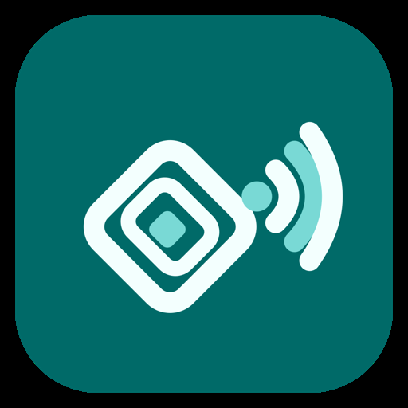
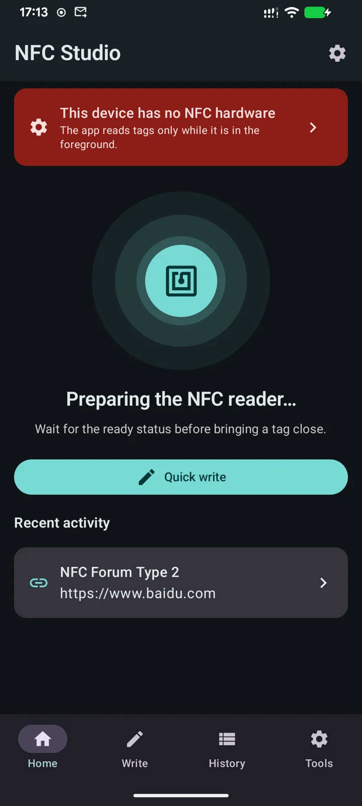
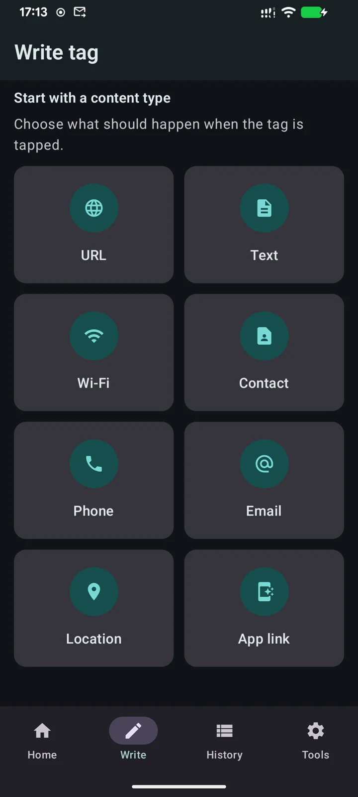
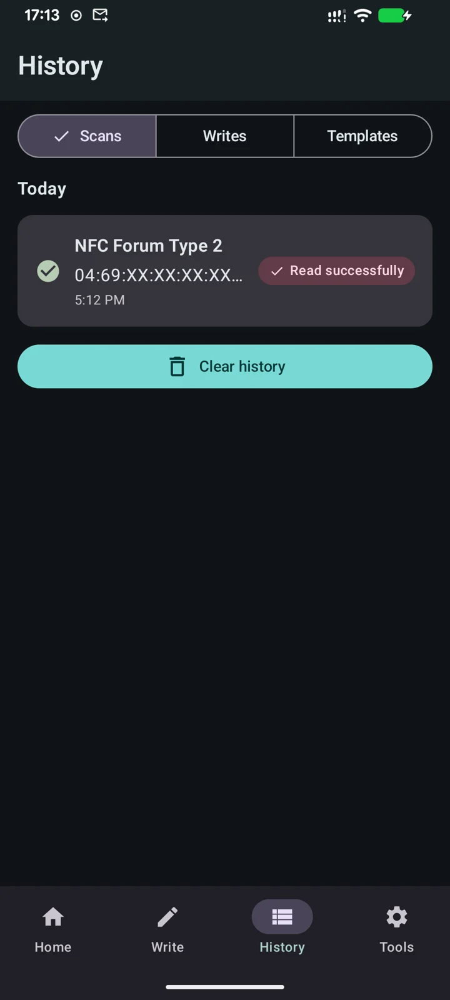

<h1 align="center">NFC Studio</h1>

<strong>Lee. Comprende. Escribe.</strong>

Herramientas NFC prácticas para Android.

<a href="https://play.google.com/store/apps/details?id=com.hienao.nfc.studio">Descargar en Google Play</a> · <a href="https://hienao-apps.pages.dev/nfc-studio/">Sitio web</a>

<a href="README.md">English</a> · <a href="README.zh-CN.md">简体中文</a> · <a href="README.ja.md">日本語</a> · <a href="README.de.md">Deutsch</a> · Español · <a href="README.pt-BR.md">Português (Brasil)</a> · <a href="README.id.md">Bahasa Indonesia</a> · <a href="README.ar.md">العربية</a> · <a href="README.ru.md">Русский</a>

  
  
  

Imágenes públicas de Google Play. Pulsa para ampliar; la versión instalada puede tener otro aspecto.

## Trabaja con tus etiquetas

NFC Studio muestra tecnologías, capacidad, estado de escritura y registros NDEF. Escribe texto, enlaces, Wi-Fi o contactos en etiquetas compatibles y verifica el resultado mediante una nueva lectura. El historial, las plantillas y las etiquetas con nombre se guardan en el dispositivo, sin crear una cuenta. Importa contenido QR compatible y mueve datos locales con JSON.

## Primeros pasos

1. Instala la aplicación en un dispositivo con NFC y Android 7.0 o posterior.
2. Activa NFC, abre la aplicación en primer plano y acerca la etiqueta a la antena.
3. Revisa el contenido. Para escribir, utiliza una etiqueta compatible y escribible, sin moverla hasta terminar la verificación.

La compatibilidad depende de la versión, el hardware, la capacidad y las restricciones de acceso. No clona UID, extrae claves ni elude la autenticación. Copiar datos compatibles no reproduce una credencial protegida.

## Gratis y Pro

La lectura, escritura NDEF estándar, verificación, historial, plantillas y copias JSON son gratuitas. Pro añade escritura por lotes, comparación, informes CSV/PDF, escritura autenticada compatible y herramientas NTAG21x/MIFARE Classic. No muestra banners mientras Pro está activo.

La aplicación principal ofrece una prueba de siete días que tú activas y una compra permanente de pago único. La prueba no requiere pago ni cobra al finalizar. La versión 1.1.14 añade una suscripción anual, enviada a revisión el 28 de octubre de 2026; su disponibilidad pública aún no está confirmada. La suscripción anual se renueva automáticamente salvo cancelación en Google Play. Los planes disponibles y precios locales se muestran antes de comprar. Restaura compras con la cuenta original de Play.

## Datos y ayuda

El contenido NFC se procesa localmente. Mostrar el UID completo y guardar todo el contenido están desactivados por defecto. El historial se conserva 30 días y se limpia al iniciar; las plantillas y etiquetas guardadas permanecen hasta que las elimines. Los análisis de uso e informes de fallos son opcionales y están desactivados por defecto. Publicidad, pagos y diagnósticos de ML Kit pueden utilizar servicios de Google; Pro no elimina todos los SDK.

La interfaz y las introducciones admiten inglés, chino, japonés, alemán, español, portugués, indonesio, árabe y ruso. Guías en [inglés](docs/getting-started.md) y [chino simplificado](docs/zh-CN/getting-started.md); preguntas frecuentes en [inglés](docs/faq.md) y [chino simplificado](docs/zh-CN/faq.md).

[Informa de un problema](https://github.com/hienao/NFC-Studio/issues/new?template=bug_report.yml) o [sugiere una función](https://github.com/hienao/NFC-Studio/issues/new?template=feature_request.yml) en inglés o chino. No publiques UID, contenido personal, contraseñas, claves ni copias reales. [Contribuir (EN/ZH)](CONTRIBUTING.md) · [Cambios (EN/ZH)](CHANGELOG.md).

Este repositorio contiene presentación, documentación y comentarios. El código de la aplicación es privado; no concede una licencia de código abierto para la aplicación ni sus recursos.

[Sitio web (EN/ZH/JA/DE)](https://hienao-apps.pages.dev/nfc-studio/) · [Privacidad (EN/ZH/JA/DE)](https://hienao-apps.pages.dev/nfc-studio/privacy/) · [Soporte](mailto:shiwentao666@gmail.com)
