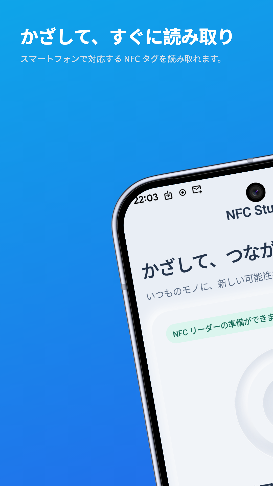
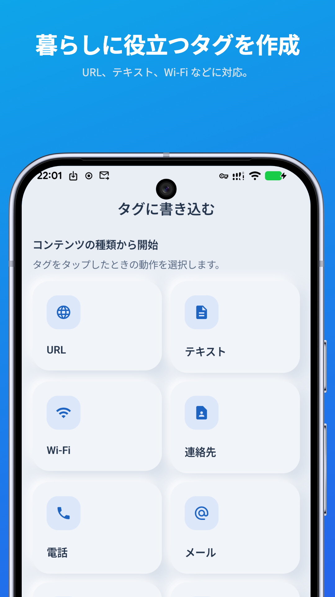
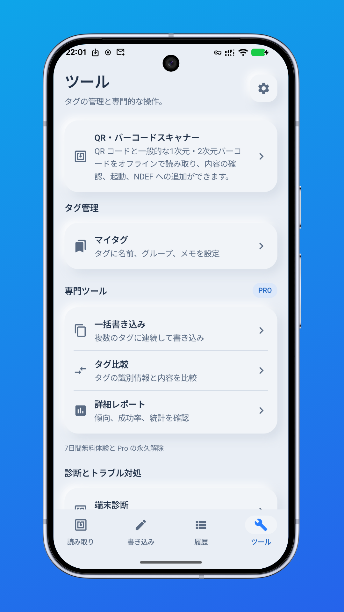
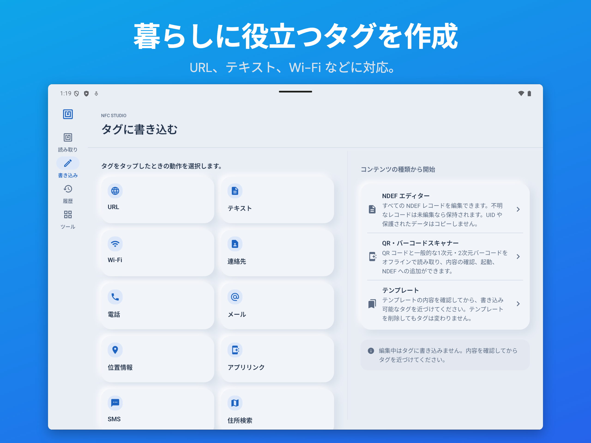

<h1 align="center">NFC Studio</h1>

<strong>読む。理解する。書き込む。</strong>

Android 用の実用的な NFC タグツール。

<a href="https://play.google.com/store/apps/details?id=com.hienao.nfc.studio">Google Play で入手</a> · <a href="https://hienao-apps.pages.dev/nfc-studio/">公式サイト</a>

<a href="README.md">English</a> · <a href="README.zh-CN.md">简体中文</a> · 日本語 · <a href="README.de.md">Deutsch</a> · <a href="README.es.md">Español</a> · <a href="README.pt-BR.md">Português (Brasil)</a> · <a href="README.id.md">Bahasa Indonesia</a> · <a href="README.ar.md">العربية</a> · <a href="README.ru.md">Русский</a>

  
  
  

スマートフォンとタブレットの画面プレビュー。クリックで拡大できます。画面や機能はバージョンにより異なります。

## NFC タグをもっと便利に

NFC Studio はタグの技術、容量、書き込み状態、NDEF レコードを確認し、互換性のあるタグにテキスト、URL、Wi-Fi、連絡先などを書き込めます。書き込み後は読み戻して検証します。履歴、テンプレート、名前付きタグは端末内に保存され、アカウントは不要です。対応する QR 内容の取り込みやローカル JSON の入出力も利用できます。

## はじめに

1. NFC 搭載の Android 7.0 以降の端末にアプリをインストールします。
2. システム設定で NFC を有効にし、アプリを前面にしたままタグをアンテナに近づけます。
3. 内容を確認します。書き込む場合は互換性のある書き込み可能なタグを使い、検証が終わるまで動かさないでください。

実際の対応範囲はバージョン、端末、タグの容量とアクセス制限によって異なります。UID の複製、鍵の抽出、保護の回避はできません。対応するデータのコピーは、保護された認証情報の複製ではありません。

## 無料と Pro

基本の読み書き、検証、履歴、テンプレート、JSON バックアップは無料です。Pro は一括書き込み、比較、CSV/PDF レポート、対応する認証書き込み、NTAG21x/MIFARE Classic ツールを提供し、有効期間中はバナー広告を表示しません。

メインアプリ内で任意に開始する 7 日間の試用、または買い切りを選べます。試用は支払い不要で、終了時に自動課金されません。1.1.14 は年間プランを追加し、2026 年 10 月 28 日に審査提出済みですが、公開は未確認です。年間プランは Google Play で解約しない限り自動更新されます。利用可能なプランと現地価格は購入前に表示されます。購入の復元は元の Play アカウントで行います。

## データとサポート

タグ内容は端末内で処理します。完全な UID 表示と全文保存は初期設定で無効です。スキャン・書き込み履歴は起動時の整理により 30 日を超えた分が削除され、テンプレートと保存タグは削除するまで残ります。利用分析とクラッシュ報告は任意で、初期設定は無効です。広告、決済、ML Kit の診断には Google サービスが関わる場合があります。Pro でもすべての SDK が削除されるわけではありません。

アプリと紹介ページは英語、中国語、日本語、ドイツ語、スペイン語、ポルトガル語、インドネシア語、アラビア語、ロシア語に対応します。詳細ガイドは[英語](docs/getting-started.md)と[簡体字中国語](docs/zh-CN/getting-started.md)、FAQ は[英語](docs/faq.md)と[簡体字中国語](docs/zh-CN/faq.md)です。

[問題報告](https://github.com/hienao/NFC-Studio/issues/new?template=bug_report.yml)・[機能提案](https://github.com/hienao/NFC-Studio/issues/new?template=feature_request.yml)は英語または中国語で受け付けます。UID、個人情報、パスワード、鍵やバックアップを公開しないでください。[貢献方法（英語・中国語）](CONTRIBUTING.md)・[更新履歴（英語・中国語）](CHANGELOG.md)。

このリポジトリは紹介・文書・フィードバック用です。非公開のアプリソースは含まず、アプリや素材のオープンソース利用許諾も付与しません。

[公式サイト (EN/ZH/JA/DE)](https://hienao-apps.pages.dev/nfc-studio/) · [プライバシーポリシー（英語・中国語・日本語・ドイツ語）](https://hienao-apps.pages.dev/nfc-studio/privacy/) · [サポート](mailto:shiwentao666@gmail.com)
