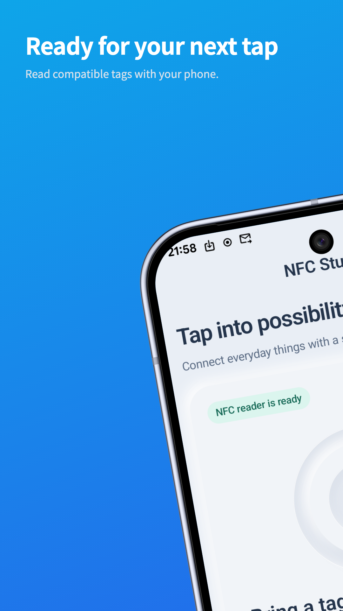
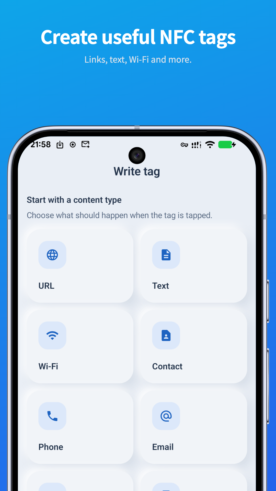
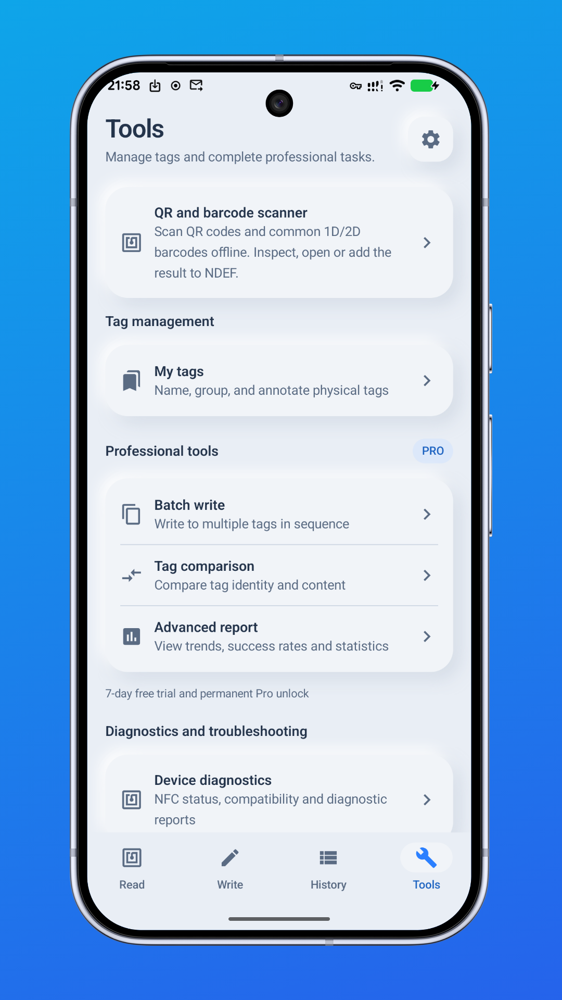
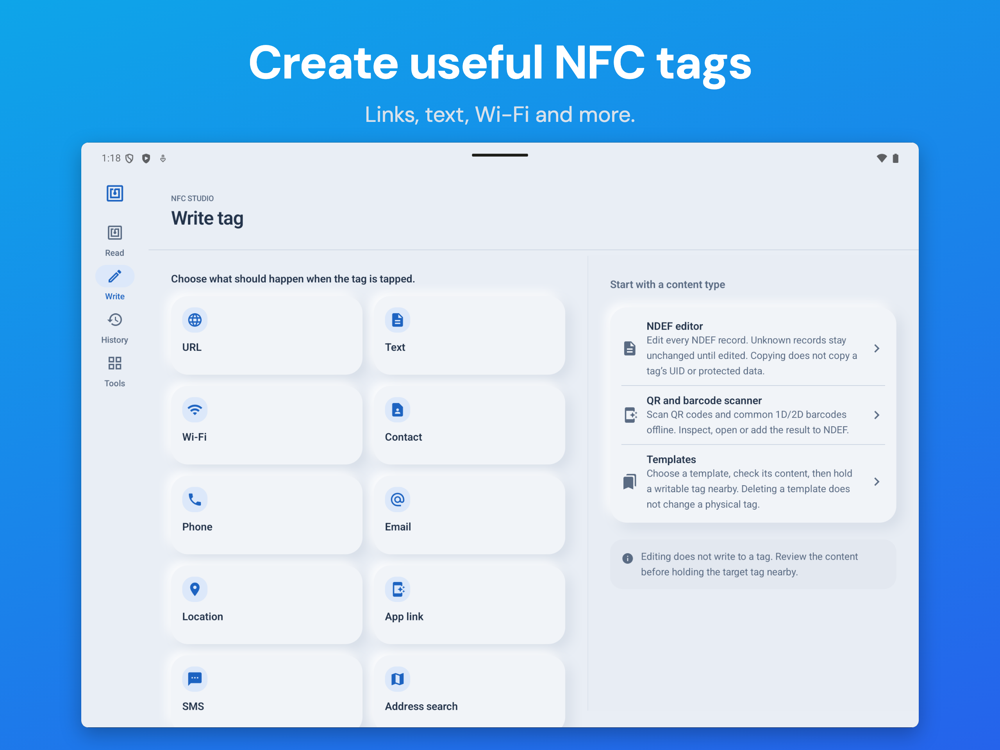

<h1 align="center">NFC Studio</h1>

<strong>Leia. Entenda. Grave.</strong>

Ferramentas NFC práticas para Android.

<a href="https://play.google.com/store/apps/details?id=com.hienao.nfc.studio">Baixar no Google Play</a> · <a href="https://hienao-apps.pages.dev/nfc-studio/">Site</a>

<a href="README.md">English</a> · <a href="README.zh-CN.md">简体中文</a> · <a href="README.ja.md">日本語</a> · <a href="README.de.md">Deutsch</a> · <a href="README.es.md">Español</a> · Português (Brasil) · <a href="README.id.md">Bahasa Indonesia</a> · <a href="README.ar.md">العربية</a> · <a href="README.ru.md">Русский</a>

  
  
  

Prévia do app no celular e no tablet. Toque para ampliar; a aparência e a disponibilidade podem variar conforme a versão.

## Cuide das suas tags

O NFC Studio mostra tecnologias, capacidade, estado de gravação e registros NDEF. Grave textos, links, Wi-Fi ou contatos em tags compatíveis e confira o resultado com uma nova leitura. Histórico, modelos e tags nomeadas ficam no aparelho, sem criar conta. Importe conteúdo QR compatível e transfira dados locais por JSON.

## Primeiros passos

1. Instale em um aparelho com NFC e Android 7.0 ou superior.
2. Ative o NFC, abra o aplicativo em primeiro plano e aproxime a tag da antena.
3. Confira o conteúdo. Para gravar, use uma tag compatível e gravável, mantendo-a parada até a verificação terminar.

O suporte depende da versão, do hardware, da capacidade e das restrições de acesso. O app não clona UID, extrai chaves nem contorna autenticação. Copiar dados compatíveis não reproduz uma credencial protegida.

## Grátis e Pro

Leitura, gravação NDEF padrão, verificação, histórico, modelos e backup JSON são gratuitos. O Pro oferece gravação em lote, comparação, relatórios CSV/PDF, gravação autenticada compatível e ferramentas NTAG21x/MIFARE Classic. Banners não aparecem enquanto o Pro está ativo.

No aplicativo principal, você pode iniciar um teste de sete dias ou comprar acesso vitalício com pagamento único. O teste não exige pagamento e não cobra ao terminar. A versão 1.1.14 adiciona assinatura anual, enviada para análise em 28 de outubro de 2026; a disponibilidade pública ainda não foi confirmada. A assinatura anual renova automaticamente, salvo cancelamento no Google Play. Planos disponíveis e preços locais aparecem antes da compra. Restaure compras com a conta original do Play.

## Dados e ajuda

O conteúdo NFC é processado localmente. Exibir o UID completo e salvar todo o conteúdo ficam desativados por padrão. O histórico é mantido por 30 dias, com limpeza ao iniciar; modelos e tags salvas permanecem até a exclusão. Análise de uso e relatórios de falhas são opcionais e desativados por padrão. Publicidade, pagamentos e diagnósticos do ML Kit podem usar serviços do Google; o Pro não remove todos os SDKs.

Interface e apresentações estão disponíveis em inglês, chinês, japonês, alemão, espanhol, português, indonésio, árabe e russo. Guias em [inglês](docs/getting-started.md) e [chinês simplificado](docs/zh-CN/getting-started.md); FAQ em [inglês](docs/faq.md) e [chinês simplificado](docs/zh-CN/faq.md).

[Relate um problema](https://github.com/hienao/NFC-Studio/issues/new?template=bug_report.yml) ou [sugira uma função](https://github.com/hienao/NFC-Studio/issues/new?template=feature_request.yml) em inglês ou chinês. Não publique UIDs, conteúdo pessoal, senhas, chaves ou backups reais. [Contribuir (EN/ZH)](CONTRIBUTING.md) · [Alterações (EN/ZH)](CHANGELOG.md).

Este repositório reúne apresentação, documentação e feedback. O código do aplicativo é privado; nenhuma licença de código aberto para o app ou seus recursos é concedida aqui.

[Site (EN/ZH/JA/DE)](https://hienao-apps.pages.dev/nfc-studio/) · [Privacidade (EN/ZH/JA/DE)](https://hienao-apps.pages.dev/nfc-studio/privacy/) · [Suporte](mailto:shiwentao666@gmail.com)
