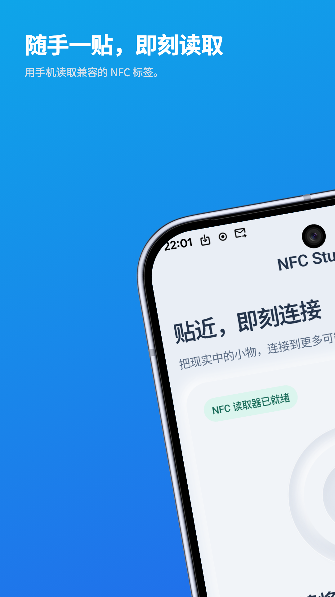
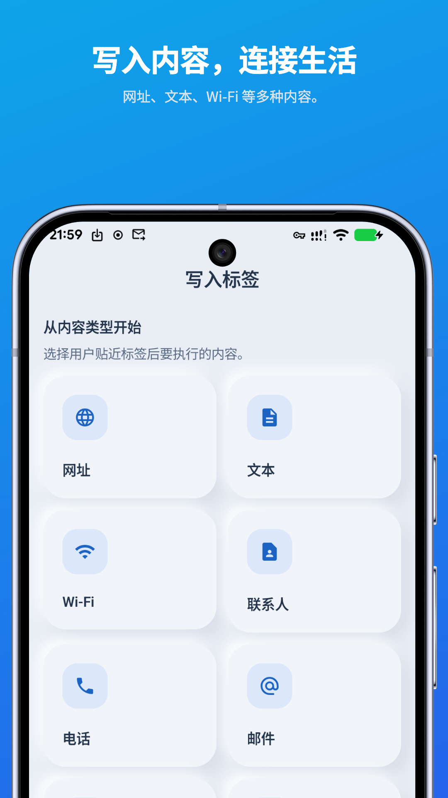
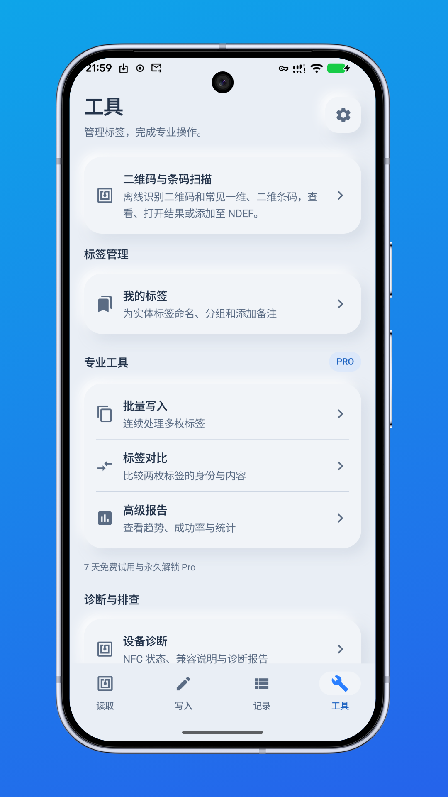
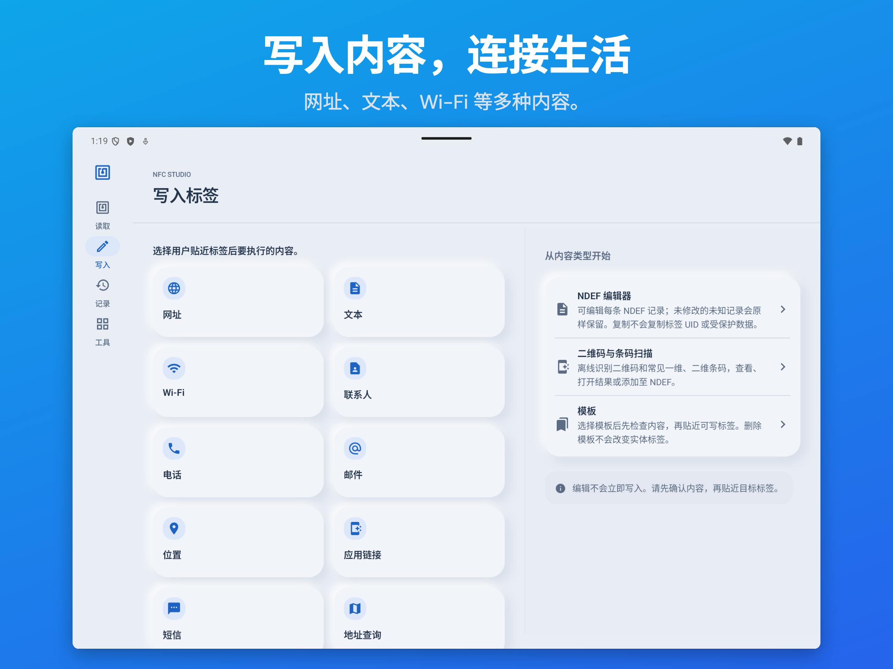

<h1 align="center">NFC Studio</h1>

<strong>读取、理解、写入。</strong>

面向 Android 的实用 NFC 标签工具。

<a href="https://play.google.com/store/apps/details?id=com.hienao.nfc.studio">前往 Google Play</a> · <a href="https://hienao-apps.pages.dev/nfc-studio/">官方网站</a>

<a href="README.md">English</a> · 简体中文 · <a href="README.ja.md">日本語</a> · <a href="README.de.md">Deutsch</a> · <a href="README.es.md">Español</a> · <a href="README.pt-BR.md">Português (Brasil)</a> · <a href="README.id.md">Bahasa Indonesia</a> · <a href="README.ar.md">العربية</a> · <a href="README.ru.md">Русский</a>

  
  
  

手机与平板界面预览，点击可放大；具体界面和功能取决于安装版本。

NFC Studio 帮你检查 NFC 标签、编辑标准 NDEF 内容并写入兼容标签。扫描记录、模板和已命名标签保存在本机，无需注册账号。

## 轻轻一碰，了解标签

- **查看标签信息。** 检查技术类型、可用容量、可写状态和 NDEF 记录，查看原始字段以辅助排查。
- **写入常用内容。** 准备文本、网址、Wi-Fi、联系人、电话、邮件或位置；写入前检查兼容性与容量，写入后回读验证。
- **复用已有内容。** 保存模板，为标签命名和添加备注，通过本地 JSON 导入、导出迁移数据。
- **导入二维码。** 使用相机导入受支持的文本、网址或 Wi-Fi 内容，也可以直接粘贴。
- **使用 Pro 工具。** 批量写入、标签对比、CSV/PDF 报告导出、认证写入，以及兼容 NTAG21x 和 MIFARE Classic 标签的高级工具。

具体功能取决于安装版本、手机 NFC 硬件、标签能力和访问限制。复制受支持的数据不等于复制 UID，也不能复现受保护的凭证。

## 开始使用

1. 在支持 NFC 的 Android 设备上安装 [NFC Studio](https://play.google.com/store/apps/details?id=com.hienao.nfc.studio)，要求 Android 7.0 或更高版本。
2. 在系统设置中开启 NFC，打开应用，将兼容标签靠近手机 NFC 天线区域。
3. 查看读取结果；需要写入时，准备 NDEF 内容并按照提示贴近兼容的可写标签，保持稳定直至操作和验证完成。

[读取与写入指南](docs/zh-CN/getting-started.md) · [常见问题与排查](docs/zh-CN/faq.md)

## 免费功能与 Pro

| | 免费基础功能 | Pro 权益 |
| --- | --- | --- |
| 基础读取、标准 NDEF 写入与验证 | 包含 | 包含 |
| 历史、模板与本地 JSON 备份 | 包含 | 包含 |
| 批量写入、对比和高级报告 | — | 包含 |
| 受支持的认证写入和高级标签工具 | — | 包含 |
| 横幅广告 | 可能展示，受隐私选择影响 | Pro 有效期内不展示 |

Pro 在主应用内提供：你可以主动开启 7 天试用，或一次性永久买断。本地试用无需付款，到期不会自动扣费。恢复符合条件的购买时，请使用原 Google Play 购买账号。

**年度方案：** 1.1.14 在永久买断之外新增 Pro 年度订阅，已于 2026 年 10 月 28 日提交审核，尚未确认公开上线。年度订阅自动续费，可在 Google Play 取消；可用方案和当地价格以应用购买前展示为准。当前主应用的升级流程无需安装旧的独立 Pro 应用。

## 标签数据留在本机

NFC 标签内容在本机处理。完整 UID 默认隐藏，完整内容保存默认关闭。扫描与写入历史保留 30 天，应用启动清理时移除更早记录；模板和已保存标签保留至你主动删除或清除应用数据。

可选的 Firebase 使用分析和崩溃报告默认关闭，可分别开启。广告、支付及 ML Kit 诊断可能通过 Google 服务处理部分数据；Pro 不代表移除了所有第三方 SDK。详情见[官方隐私政策](https://hienao-apps.pages.dev/nfc-studio/privacy/)。导出文件可能包含敏感标签或模板内容，请妥善保管。

## 语言

应用界面与本仓库介绍提供英文、简体中文、日文、德文、西班牙文、葡萄牙文、印尼文、阿拉伯文和俄文。详细指南与 FAQ 提供[英文](docs/faq.md)和[简体中文](docs/zh-CN/faq.md)。

## 一起改进 NFC Studio

欢迎[反馈问题](https://github.com/hienao/NFC-Studio/issues/new?template=bug_report.yml)或[建议功能](https://github.com/hienao/NFC-Studio/issues/new?template=feature_request.yml)，支持中文和英文。请提供应用版本、设备、Android 版本、标签类型及复现步骤。移除 UID、密码、密钥和个人内容，勿上传真实备份。

文档修正与翻译可通过 PR 提交，详见[贡献说明](CONTRIBUTING.md)。[更新记录](CHANGELOG.md)列出部分主要变化；如果应用对你有帮助，欢迎点亮 Star。

## 关于本仓库

本仓库用于 NFC Studio 的公开介绍、使用文档和用户反馈，不包含私有应用源码，也不授予应用或素材的开源许可。

[官方网站](https://hienao-apps.pages.dev/nfc-studio/) · [隐私政策](https://hienao-apps.pages.dev/nfc-studio/privacy/) · [支持邮箱](mailto:shiwentao666@gmail.com)
